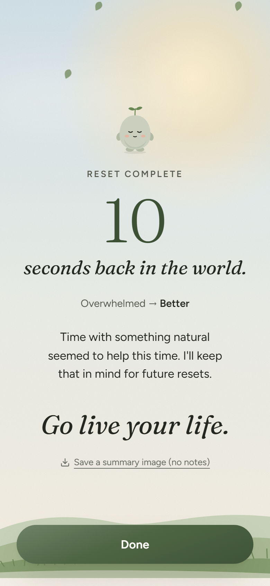
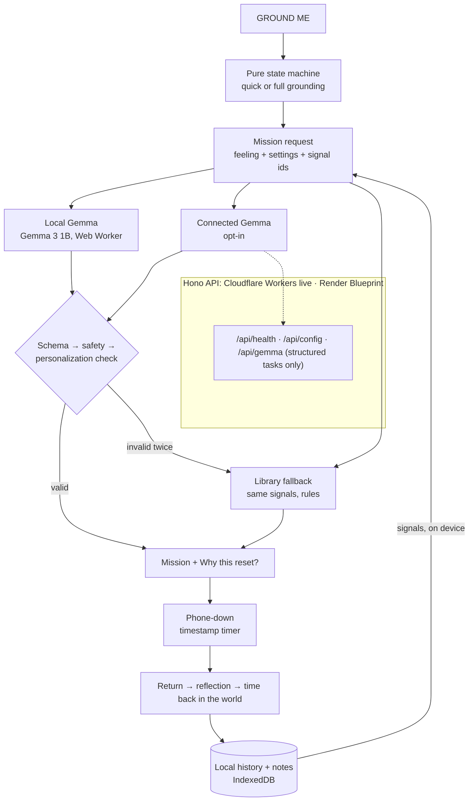
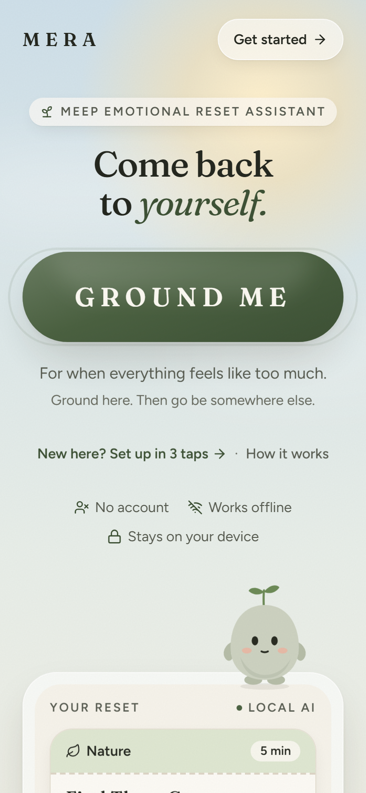
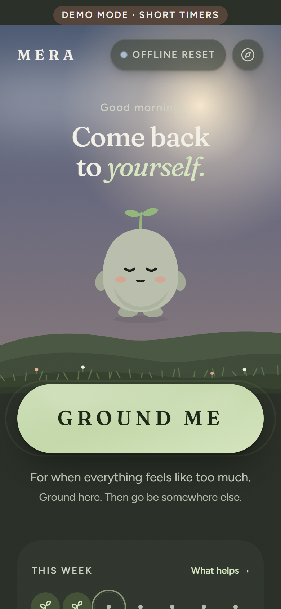
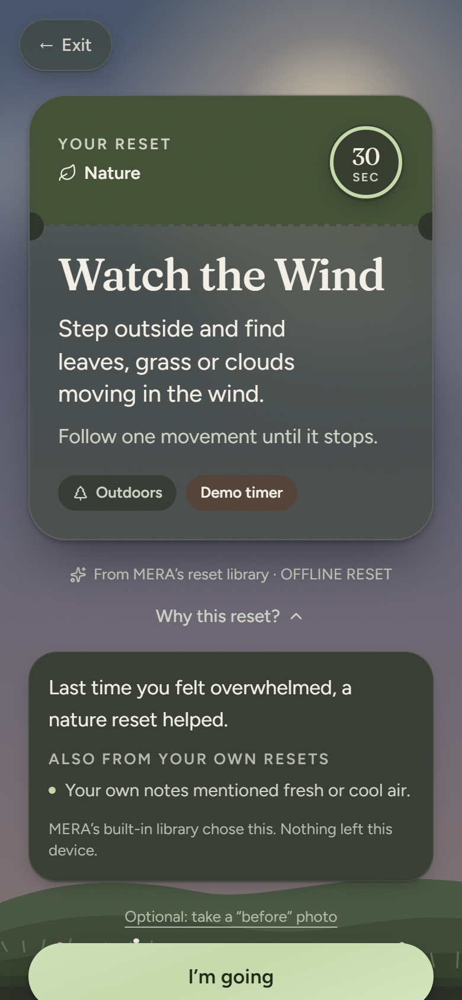
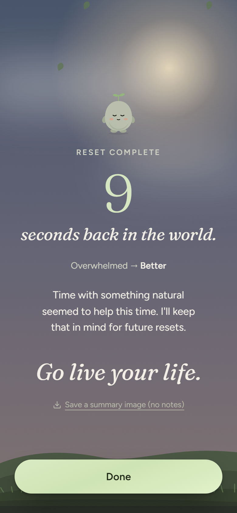

# MERA

### Meep Emotional Reset Assistant

**Come back to yourself.**

MERA is an open-weight AI grounding companion designed to get you off your screen, not keep you on it.

When everything feels like too much, press **GROUND ME**. MERA helps you pause, gives you **one personalized real-world reset**, then tells you to put your phone away.

> MERA uses AI to shorten the digital experience, not extend it.
> **MERA is designed to help you leave MERA.**

**Live:** https://mera.casmazariegos.workers.dev · Built for **Hacktoberfest 2026, Week 1: Touch Grass** · Targets: _Best Use of Gemma_, _Best Use of Render_

<p>
  
  
  
  
</p>

---

## Overview

A mobile-first, installable web app (PWA). One button starts a short grounding sequence. As soon as you're ready, MERA hands you **one** small real-world mission, chosen by **Gemma** from what has actually helped _you_ before. Then: _"Good. Now put me away. Go touch grass. I'll be here when you get back."_ A nearly empty timer screen waits while you're gone. When you come back, one tap says how it went, and MERA shows how long you were **back in the world**.

```
CHAOS → "I'm here." → ground → breathe → "I'm ready to step away"
      → one personalized Gemma mission → (Why this reset?) → "Good." → "Now put me away."
      → REAL WORLD, phone down → "Welcome back." → better / same / worse
      → optional note → one short insight → "6 minutes back in the world." → "Go live your life."
```

## Why MERA exists

Most wellness apps still ask you to stare at your phone: feeds, streaks, long chats, content libraries. When you're overwhelmed, more screen is the last thing you need. MERA does the opposite: the outside world is supposed to win, and MERA's best outcome is that you close it.

## Touch Grass challenge

| The challenge asks for… | MERA |
| --- | --- |
| Open-weight AI at the core | Gemma personalizes each real-world mission from your own history and explains why ("Walking was part of 4 resets that helped"). |
| Getting people off the screen | Every reset ends in **phone-down mode**. Time away is measured from timestamps and is the product's main metric. |
| Why open matters | Feelings and notes are some of the most personal things people write. Gemma can run **in your browser**, so they don't have to leave the device. |

## The anti-engagement design

Most apps measure success by how long you stay. **MERA measures how quickly it can help you leave.**

- **The AI is intentionally brief.** Gemma returns one mission in strict JSON, plus a one-line reason. No chat.
- **The quick path is under 90 seconds.** After one breath MERA offers _"I'm ready to step away"_. Keep grounding if you want, never because you have to.
- **The phone-down screen is intentionally boring.** A timer, a tiny resting MERA, _Audio · Haptics · End early_. Nothing to read.
- **The one number MERA shows is time away.** _"6 minutes back in the world."_ Not XP, points, streaks or badges. No comparisons, no shaming.
- **The quieter you need it, the quieter MERA gets.** The character barely moves while you ground, almost disappears in phone-down mode, and only softly reappears when you return.
- **No** feeds, notifications, streaks, achievements, social features, articles or chatbots.

The most important part of MERA happens away from MERA.

## Ground Me flow

| # | Step | What happens |
| --- | --- | --- |
| 1 | I'm here | _"I'm here." / "You don't have to figure everything out right now."_ Start reset, or _I need something quieter_ (no sound, haptics or motion). |
| 2 | Body | _"Put both feet on the ground."_ Moves on by itself. |
| 3 | Breathe | In 4 · hold 2 · out 6. After one breath: **I'm ready to step away** or **Keep grounding**. |
| 4 | Senses (full path) | 5-4-3-2-1, one sense per screen, no typing. _I'm ready to step away_ stays available. |
| 5 | Feeling | _"What feels closest right now?"_ One tap. |
| 6 | Mission | One personalized real-world mission, 2–10 minutes. **Why this reset?** is there if you want it. |
| 7 | Hand-off | _"Good." → "Now put me away." → "Go touch grass. I'll be here when you get back."_ |
| 8 | Phone down | `04:58`, a tiny resting MERA, _Audio · Haptics · End early_. Nothing else. |
| 9 | Return | _"Welcome back."_ Better / About the same / Worse. After _Worse_: _"Thanks for checking back in."_, then **Try a different reset** or **Finish for now**. |
| 10 | Note | Optional: Voice, Type or Skip. |
| 11 | Complete | **Reset complete · 6 minutes back in the world**, one short insight, _"Go live your life."_ Done. |

Quick path: about 30–60 s to the mission (one breath). Full path: about 2–3 minutes.

## Why Gemma

The honest question is: _couldn't these missions just come from a list?_ The fallback can, and MERA has one (23 safety-checked missions) so it never breaks offline. **Gemma is what makes the mission yours.**

1. **Personalized missions.** MERA turns your history into small structured **signals** (below). Gemma builds a mission around them and adapts it to how you feel _now_. It doesn't just replay an old mission.
2. **Why this reset?** Gemma returns a one-sentence reason and the ids of the signals it used. Code verifies that each cited signal was really given to it, that the reason makes no claims about your past without citing one, and that every number in the reason matches a cited fact.
3. **Short reflections.** One or two sentences after a reset (your note is included only if you allow it).
4. **Gentle patterns.** Observations counted in code (_"Walking helped in 3 of the 4 recent resets that included it"_). Gemma may rephrase them; every number is checked.
5. **Open weights → local inference.** Gemma 3 1B runs in a Web Worker in your browser (WebGPU or WebAssembly). If it's unavailable, slow or fails validation, the library takes over, still personalized by the same signals.

**What Gemma does, and what plain code does.** Gemma personalizes the reset and Daily reset missions, writes the short reflection, and rephrases pattern observations. Deterministic code runs the grounding sequence, breathing, senses, the phone-down timer and time back in the world, every safety rule and check on Gemma's answers, the offline library, and all pattern counting. AI is used where it adds something, not everywhere.

## How personalization works

History stays on the device. What a model sees is a handful of ids, each rebuilt into words on whichever side reads it, so no free text is ever sent:

| Signal id | Meaning |
| --- | --- |
| `feeling_helped:overwhelmed:movement` | Last time you felt overwhelmed, a movement reset helped. |
| `cat_helped:movement:2:3` | Movement resets helped in 2 of the last 3 tries. |
| `act_helped:walking:2` | Walking was part of 2 resets that helped. |
| `cat_not_helped:indoor:2` | Indoor resets didn't help the last 2 times. |
| `note_theme:fresh_air` | Your own notes mentioned fresh or cool air (matched **on device**; only the theme id is used). |

`note_theme` signals follow the note-privacy rules. They're dropped when AI note analysis is off, and they never go to Connected AI unless you've allowed notes there. **Reset personalization** in Settings makes new missions ignore everything before that moment.

### A real example (structured input → checked output)

Captured on 2026-10-06 from the live deployment (Connected Gemma: Gemma 4 26B A4B on Workers AI) with `scripts/live-gemma-check.ts`, which runs MERA's real provider, checks and repair loop. History: two walks and a "walk around the block" that helped, one indoor reset that didn't change much, and a note saying _"Walking and the cool air helped."_

```text
Feeling: overstimulated · up to 5 min · outdoor allowed
What has helped this person (from their own past resets):
- [cat_helped:movement:2:2] Movement resets helped in 2 of the last 2 tries.
- [act_helped:walking:2]    Walking was part of 2 resets that helped.
- [note_theme:walking]      Your own notes mentioned walking.
- [note_theme:fresh_air]    Your own notes mentioned fresh or cool air.
```

```text
Cool Air Walk  [movement · outdoor · 5 min]
Step outside and walk slowly for five minutes. Focus on the feeling of the air on your skin.
Why: Movement and walking have helped in your past resets.
Cited: cat_helped:movement:2:2, act_helped:walking:2, note_theme:walking, note_theme:fresh_air
```

Same history, other settings, same run:
- **Indoor-only:** _"Slow Hallway Walk: walk slowly back and forth in a hallway or a clear space in your home."_
- **Low mobility** (MERA drops walking and movement signals before asking): _"Texture of Nature: sit quietly outside and touch the texture of a nearby plant or stone."_
- **No history:** a generic sound reset with no reason.

**The judge demo, live (2026-10-07).** The sample history (walks that helped, a sound-and-movement reset that helped, notes about cool air and birds) produces `cat_helped:movement:2:2`, `cat_helped:sensory:1:2`, `act_helped:walking:2`, `note_theme:fresh_air`, `note_theme:sound`. With the current feeling _Overstimulated_, Gemma returned, three runs in a row:

```text
Slow Walk and Listen  [movement · outdoor · 5 min]
Walk slowly through your space and notice the feeling of your feet hitting the ground.
Listen for the furthest sound you can hear.
Why: Movement, walking, and sensory-based resets have helped in the past.
```

This run also caught a real bug: the output schema allowed only 4 cited signals while a request can carry 6. A full history therefore always fell back to the library. Fixed, with a test.

The **About** screen in the app has a **Run a mission request** button. It runs exactly this against your own history and shows the structured input and the checked output, never hidden model text.

## Why open-weight AI

> Some of the most personal things people write should not require sending those thoughts to a remote proprietary AI provider.

- **Private inference.** On-device Gemma means check-ins and notes are processed on your phone.
- **Offline.** After a one-time download, the AI works without a connection. The reset library works offline from the first visit.
- **Transparent and portable.** The model, prompts, validators and evaluation are all in this repo. Swap Gemma sizes or another open model by changing one id.
- **No lock-in.** The same prompts run on-device or behind any OpenAI-compatible Gemma endpoint.

## Privacy

| | What happens |
| --- | --- |
| **Local data** | Resets, feelings, outcomes, check-ins, journal text, voice notes and photos live in **IndexedDB in this browser** (Dexie). No account. Preferences live in localStorage. |
| **Local AI** (Local Gemma) | Mission personalization runs in a Web Worker on this device. Nothing about your resets leaves it. Model files (~784 MB GPU / ~1.7 GB CPU, shown before you agree) are cached in the browser and removable. |
| **Remote AI** (Connected Gemma, opt-in) | MERA's server receives the tapped feeling, reset settings, coarse time of day and **signal ids**, rebuilds MERA's own prompts, and calls the configured Gemma endpoint (Gemma 4 on Cloudflare Workers AI for the live demo). Never location, journal, voice or photos. A note's text is sent only if you separately allow it. MERA's code doesn't store or log request content. Cloudflare's platform logs record request metadata (path, status, timing), not bodies. |
| **Offline fallback** | The built-in library, personalized by the same signals with simple rules. No network. |

## AI modes

| Indicator | Mode | In plain words |
| --- | --- | --- |
| `LOCAL AI` | Local Gemma | Mission personalization runs on this device. |
| `CONNECTED AI` | Connected Gemma (opt-in) | Mission personalization uses MERA's configured AI service. |
| `OFFLINE RESET` | Offline reset | MERA is using its built-in grounding mission library. |

The current mode shows on Home, on every mission, in Settings and in About. It's never in the way during grounding.

**Controls (all real, all tested):** Export my data (JSON) · Delete reset history · Delete journal · Delete all local data · Disable AI analysis of notes · Reset personalization · Remove the downloaded model. No analytics, no trackers, nothing sold. Voice notes are stored as audio only and are **not transcribed**.

## Offline fallback

Model output → first balanced JSON object → **Zod schema** → **safety rules** (no traffic, strangers, unfamiliar places, night outdoors, strenuous activity, bare feet, tools, medical behaviour, screens or journaling; indoor-only, low-mobility, no-sound and no-smell respected; no clinical, crisis, dependency or hype language) → **personalization check** (cited signals must exist, reason grounded, numbers match). Failure → **one repair retry** → failure again → **library**. Timeouts and network errors go straight to the library, and each mission request has a **15-second budget**: if Gemma isn't done by then, the library answers, so nobody waits on a model. If storage fails (private mode, full disk), the reset still finishes. Raw model text is never rendered.

## Architecture



- **State machine** (`src/features/grounding/machine.ts`): `INTRO → BODY_AWARENESS → BREATHING → (STEP_AWAY →) SENSE_5…SENSE_1 → EMOTION_CHECK → MISSION_GENERATION → MISSION_READY → PHONE_DOWN → RETURN → REFLECTION → AI_REFLECTION → COMPLETE`, plus `TRY_ANOTHER` after "worse". It's persisted, so a refresh resumes where you were. You can exit from any step.
- **Phone-down timer:** `startedAt`, `expectedEndAt` and planned duration are stored. Remaining time is computed from timestamps, so screen lock, background throttling and refresh don't skew it. If the timer ends while the screen is off, the gentle cue plays and **the time until you actually come back counts too** (capped at 30 minutes over). Each reset stores `plannedSeconds`, `phoneDownSeconds` (actual), `timerCompleted` and `path`.
- **Code:** `src/ai` (providers, prompts, schemas, safety, local model) · `src/features/missions` (library, selection, signals) · `server/` (Hono API shared by Node and Workers).

## Technology stack

React 19 · TypeScript (strict) · Vite 8 · Tailwind CSS v4 · Motion · Zod · Zustand · Dexie · vite-plugin-pwa (Workbox) · transformers.js + ONNX Runtime Web · Hono (Node and Cloudflare Workers) · Vitest + React Testing Library + Playwright + axe-core · ESLint + Prettier.

Secondary pages are code-split and precached, so Home and the reset flow load first and everything works offline. The local model only downloads after you agree in Settings, then initializes in a Web Worker.

## Local development

```bash
npm install
npm run dev          # http://localhost:5173
npm run dev:api      # optional: API on :8787 (Vite proxies /api)
npm run build && npm start   # production server locally: http://localhost:8787
```

### Environment variables

| Variable | Default | Purpose |
| --- | --- | --- |
| `APP_ENV` | `development` | Reported by `/api/health`. |
| `PORT` | `8787` | Server port (Render sets this). |
| `ENABLE_LOCAL_AI` | `true` | Advertised in `/api/config`. |
| `ENABLE_REMOTE_AI` | `false` | Turn on Connected AI. |
| `MODEL_PROVIDER` | `openai` | `openai` (any OpenAI-compatible endpoint) or `workers-ai`. |
| `MODEL_ENDPOINT` | — | OpenAI-compatible base URL serving Gemma, e.g. Google AI Studio or Ollama (`http://localhost:11434/v1`). |
| `MODEL_NAME` | — | e.g. `gemma-3-27b-it`, `gemma3:4b`, or `@cf/google/gemma-4-26b-a4b-it`. |
| `MODEL_API_KEY` | — | Secret. Server-side only. |
| `REMOTE_AI_RATE_LIMIT` | `40` | Requests per client per 10 minutes. |

## Deployment

### Cloudflare Workers (the live demo)

https://mera.casmazariegos.workers.dev runs on Workers: the PWA via Static Assets (SPA fallback, security headers from `public/_headers`), and `/api/*` via `server/worker.ts`, which is the same Hono API as the Node server. Connected Gemma is **Gemma 4 26B A4B on Workers AI** through the `AI` binding (no key in the repo).

```bash
npm run deploy:cf   # build → drop the unused >25 MiB ORT wasm → wrangler deploy
```

### Render

MERA ships a **Render Blueprint** (`render.yaml`): one Node web service that builds the PWA and serves it with the API, with `healthCheckPath: /api/health`.

1. Push the repo to GitHub.
2. Render → **New → Blueprint** → pick the repo (build `npm ci && npm run build`, start `npm start`).
3. Optional Connected AI: set `ENABLE_REMOTE_AI=true`, `MODEL_ENDPOINT`, `MODEL_NAME` and the secret `MODEL_API_KEY`.

> **Status, stated plainly:** the live demo is currently hosted on Cloudflare Workers, **not** Render. The Render Blueprint is complete and the Node server is what the Playwright suite runs against, but a public Render deployment hasn't been made yet.

## Accessibility

- **Structure and keyboard:** semantic headings focused on every scene, fully keyboard-operable, visible focus, Escape exits a reset, and the rest of the app is `inert` during one.
- **Touch and contrast:** 44–56 px touch targets; WCAG AA contrast in light and dark (axe-verified), plus a higher-contrast option and text-size options.
- **Motion and senses:** reduced motion (OS or MERA setting); breathing is fully conveyed by words and a countdown; sound and haptics are optional and always paired with text.
- **Timer:** a `role="timer"` that updates once a minute (no chatter).
- **Colour:** state never depends on colour alone.

## Safety boundaries

MERA is a grounding and wellness tool. It is **not** therapy, a diagnosis, a treatment, or a crisis service, and it doesn't replace professional care. It never diagnoses, never gives medical advice, and filters AI output for clinical language. Pattern insights are observations ("seems", "has helped"), never conclusions. If you're in danger, contact local emergency services or a crisis line where you live.

## Real-world test

> To be completed with a real reset before submission. Nothing here is invented.

| | |
| --- | --- |
| Before | _(feeling)_ |
| MERA mission | _(mission, source)_ |
| Off-screen time | _(from the Complete screen)_ |
| After | _(better / same / worse)_ |
| Observation | _(the insight MERA showed)_ |

Complete → **Save a summary image** creates a private PNG with only the mission title, time back in the world and the date (no notes or feelings), for documenting it.

## Screenshots

| Light | Dusk (dark) |
| --- | --- |
|  |  |
|  |  |
|  |  |

All screenshots are in `docs/screenshots/` (phone size, captured with `scripts/screenshots.ts`, light and dark). They come from a browser, not a physical phone.

## Demo mode

Settings → **Set up judge demo**. This turns on Demo mode (clearly labelled: 30-second phone-down, choice to step away after one breath) and adds **sample** resets and two sample notes ("Walking and the cool air helped."), all marked _sample_ and removable in one tap. The AI and everything else is real.

Home → **GROUND ME** → _I'm here_ → feet on the ground → one breath → **I'm ready to step away** → _Overstimulated_ → a personalized mission → **Why this reset?** → **I'm going** → _Good. Now put me away. Go touch grass._ → 30-second timer → _Welcome back_ → **Better** → optional note → short insight → **"N minutes back in the world"** → _Go live your life._ Then About → **Run a mission request** to see the structured input and output.

## Testing

```bash
npm test            # unit + component + server (Vitest, RTL)
npm run test:e2e    # Playwright against the production Node server, incl. axe
npm run lint && npm run typecheck
npm run eval        # real-model mission evaluation (downloads Gemma 3 1B, CPU)
```

**Covered:** the personalization pipeline traced from what's stored in IndexedDB → request → Gemma's prompt → structured answer → validation → rendered mission (with and without history, and after reset personalization), a large history staying bounded, state transitions (quick and full paths, step-away, try-another), timestamp timing (end early, return after the timer while the screen was off, cap), breathing and sensory flow, personalization signals (derivation, id validation, reset cutoff, note privacy by mode), history changing the mission (library and prompt), Gemma output checks (invented signals, unfounded or ungrounded reasons, clinical language, empty fields), safety rules, repair-then-fallback, reflection and pattern wording, storage, export and every delete, demo data isolation, and the server (health, config, structured-only Gemma proxy, headers, rate limit).

**End to end:**
- The full flow, and the quick path to a personalized mission in under 90 s.
- "Worse" → *Try a different reset*.
- Phone-down surviving a refresh, and a timer that ends while the screen is off (MERA waits, and that time counts).
- Offline use, delete-all, and first-run onboarding.
- **axe-core (WCAG 2.2 AA) on 14 screens in light and dark.**
- No horizontal scroll at 320, 360, 375, 390, 414 and 430 px.

## Measured results

The earlier run used real Gemma 3 1B (q4, CPU via transformers.js) through MERA's actual prompts, validators and safety rules. It was partial, covering 11 of 18 synthetic cases before the machine ran out of memory: **8 accepted (2 after the one repair retry), 3 fell back to the library, 0 unsafe missions shown.** That predates the personalization prompt and hasn't been re-measured yet. Details: [docs/EVALUATION.md](docs/EVALUATION.md).

## Roadmap

- Re-run `npm run eval` on the personalization prompt; then a MERA-tuned Gemma (Tinker), measured against the base.
- On-device speech-to-text for voice notes (open model, no third-party audio).
- A smaller on-device model option for phones.

## Contributing

Issues and PRs welcome. Before adding a feature, ask: _does this help someone return to the real world?_ If not, it probably doesn't belong in MERA.

## License

[MIT](LICENSE) © 2026 Cassandra Mazariegos (NextRealm Interactive). Gemma models are not part of this repository and remain under the [Gemma Terms of Use](https://ai.google.dev/gemma/terms).

## Credits

- MERA by **Cass - NextRealm Interactive**, part of the Meep universe.
- The resumable model download and device check are adapted from the author's MIT-licensed [Meeply](https://github.com/CasMazariegos/meeply).
- Gemma by Google DeepMind · transformers.js and ONNX community models by Hugging Face · Figtree and Fraunces (SIL OFL).
