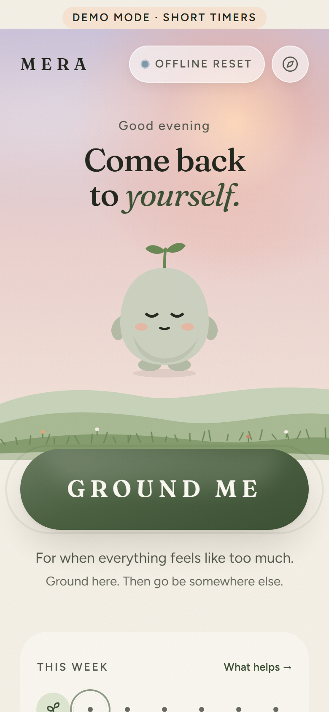
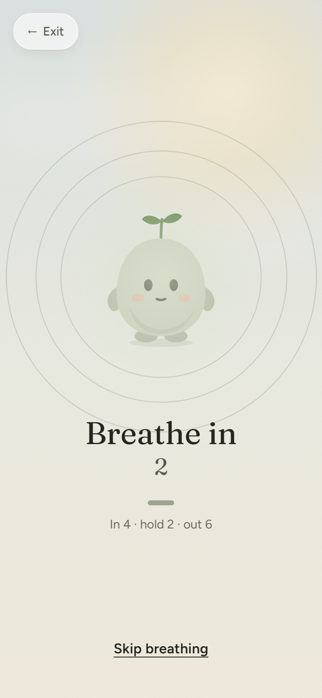
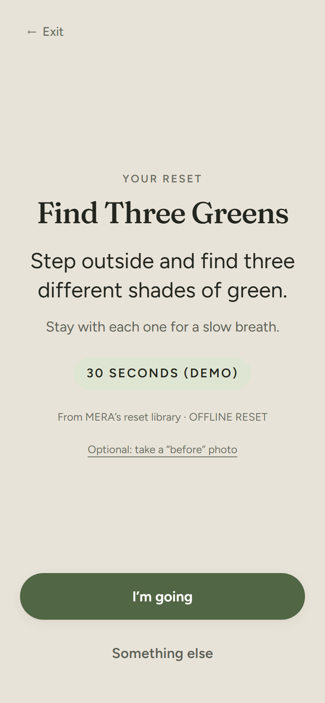
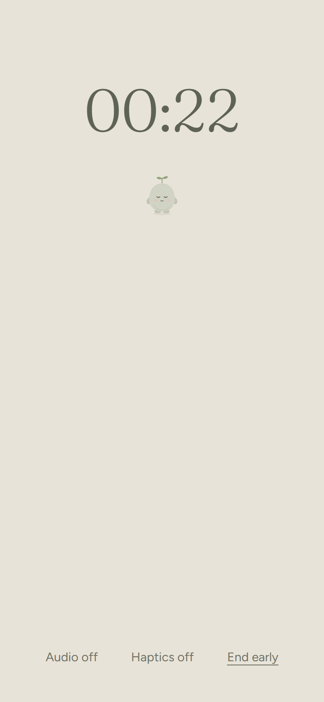
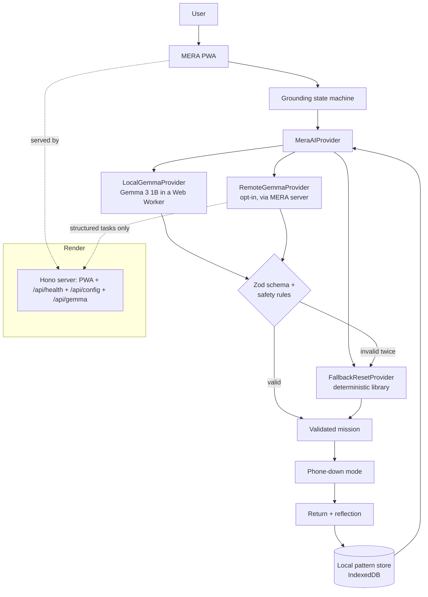

# MERA

**Meep Emotional Reset Assistant**

_Come back to yourself._
Your Meep for the moments that feel like too much.

> MERA uses AI to shorten the digital experience, not extend it.
> **MERA helps you leave MERA.**

<p>
  
  
  
  
</p>

---

## Overview

MERA is a mobile-first, installable web app (PWA) for the moments when everything feels like too much. You press one button — **GROUND ME** — and within a couple of taps MERA guides a 1–2 minute grounding sequence, then an open-weight **Gemma** model picks **one short real-world mission** for you. MERA asks you to put the phone away, waits quietly, and welcomes you back. Then it gets out of the way.

It is built for the **Hacktoberfest 2026 Week 1 challenge: Touch Grass** — open-source AI that gets people off the screen and into the world.

## Why MERA exists

Most wellness apps still ask you to stare at your phone: feeds, streaks, long chats, content libraries. When you're overwhelmed, more screen is the last thing you need. MERA does the opposite: the outside world is supposed to win, and MERA's best outcome is that you close it.

## Touch Grass challenge

| The challenge asks for…                  | MERA                                                                                                                                                             |
| ---------------------------------------- | ---------------------------------------------------------------------------------------------------------------------------------------------------------------- |
| Open-source / open-weight AI at the core | Gemma chooses each real-world mission from how you feel and what has helped before, and writes the short after-reset reflection.                                 |
| Getting people off the screen            | The core flow ends in **phone-down mode** — a nearly empty screen and a timer — after _"Good. Now put me away. Go touch grass. I'll be here when you get back."_ |
| Why open matters                         | Emotional check-ins and journal notes are some of the most personal things people write. Gemma runs **in your browser**, so they don't have to leave the device. |

## How it works

```
AI → UNDERSTAND → GROUND → ACT → PHONE DOWN → REAL WORLD → RETURN → REFLECT
```

### The GROUND ME flow

| #   | Scene            | What happens                                                                                                                                          |
| --- | ---------------- | ----------------------------------------------------------------------------------------------------------------------------------------------------- |
| 1   | Interruption     | _"I'm here." / "You don't have to figure everything out right now."_ — **Start reset** or **I need something quieter** (no sound, haptics or motion). |
| 2   | Body             | _"Put both feet on the ground."_ (moves on by itself after ~9 s)                                                                                      |
| 3   | Breath           | MERA _is_ the breathing guide: in 4 · hold 2 · out 6, three times. Words and numbers carry the timing; the animation only echoes them.                |
| 4   | Senses           | 5-4-3-2-1, one screen per sense, **no typing**.                                                                                                       |
| 5   | Check-in         | _"What feels closest right now?"_ — eight large choices, no writing.                                                                                  |
| 6   | Mission          | Gemma (or the reset library) chooses **one** real-world mission, 2–10 minutes.                                                                        |
| 7   | Signature moment | _"Good." → "Now put me away." → "Go touch grass. I'll be here when you get back."_                                                                    |
| 8   | Phone down       | `04:58`, a tiny resting MERA, _Audio · Haptics · End early_. Nothing else.                                                                            |
| 9   | Return           | _"Welcome back."_ — Better / About the same / Worse / Something else. No fake positivity.                                                             |
| 10  | Reflection       | Optional: **Voice**, **Type** or **Skip** (+ optional before/after photo).                                                                            |
| 11  | AI reflection    | 1–2 non-clinical sentences, e.g. _"Fresh air and movement seemed to help this time. I'll keep that in mind for future resets."_                       |
| 12  | Complete         | Recap, one optional pattern, _"Go live your life."_ — then home, with no more content.                                                                |

Also: **Daily Reset** (one proactive mission, no streaks — _"You made time for yourself three times this week."_), **Check In** (one tap + optional 2-minute reset), **My Patterns**, **Journal** (text, voice, photos, search, export, delete).

## Why Gemma

Gemma is MERA's intelligence layer, used where it adds something real:

1. **Generating the reset mission** — from the feeling you tapped, your preferences (outdoors? minutes? low mobility? skip sound/smell?), the time of day, and _which kinds of resets helped or didn't_ in your own history.
2. **Adapting to outcomes** — "better / same / worse" answers become counts that steer the next mission.
3. **Summarizing a reflection** in 1–2 sentences (optionally reading your note, on-device).
4. **Phrasing observed patterns** — the numbers are counted in code; Gemma may only rephrase them, and any number it uses must match.

MERA deliberately asks Gemma for **less** text: strict JSON, short sentences, one instruction.

## Why open-weight AI

> Some of the most personal things people write should not require sending those thoughts to a remote proprietary AI provider.

- **Private inference** — Gemma 3 1B runs in a Web Worker in your browser (WebGPU, or WebAssembly on the CPU). Check-ins and notes are processed on your device.
- **Offline** — after a one-time download, MERA's AI works without a connection; the reset library works offline from the first visit.
- **Transparent and portable** — the model, prompts, validators and evaluation are all in this repo. Swap Gemma sizes or another open model by changing one ID.
- **No per-user API keys, no lock-in** — the same prompts run on-device or behind any OpenAI-compatible Gemma endpoint.
- **Tunable** — `src/ai/tuning` and `src/ai/evaluation` are ready for a MERA-tuned model, measured against the base.

## Privacy

| Data                                                                     | Where it lives                                                                                                                                                                                                                                                                                                                                                       |
| ------------------------------------------------------------------------ | -------------------------------------------------------------------------------------------------------------------------------------------------------------------------------------------------------------------------------------------------------------------------------------------------------------------------------------------------------------------- |
| Resets, feelings, outcomes, check-ins, journal text, voice notes, photos | **IndexedDB in your browser only** (Dexie). No account.                                                                                                                                                                                                                                                                                                              |
| Preferences and privacy switches                                         | localStorage in your browser.                                                                                                                                                                                                                                                                                                                                        |
| On-device model files                                                    | Cache Storage in your browser, after explicit consent (~784 MB GPU / ~1.7 GB CPU, shown before download). Removable.                                                                                                                                                                                                                                                 |
| **Connected AI** (opt-in, off unless a server is configured)             | Only the tapped feeling, reset preferences, time of day (coarse), and helped/not-helped **counts** go to MERA's server, which forwards them to the configured Gemma endpoint. **Never** location, journal or voice notes. A note's text is sent for the after-reset summary **only** if you separately allow it. MERA's server doesn't store or log request content. |

Controls: export everything (JSON), delete individual journal entries or resets, delete all notes, **delete all data**, turn off AI reflection analysis, reset personalization, remove the downloaded model. No analytics, no trackers, nothing sold.

Voice notes are stored as audio only — **not transcribed**, because in-browser speech recognition would send audio to a third party.

## Architecture



- **State machine** (`src/features/grounding/machine.ts`): a pure, deterministic reducer — `IDLE → INTRO → BODY_AWARENESS → BREATHING → SENSE_5…SENSE_1 → EMOTION_CHECK → MISSION_GENERATION → MISSION_READY → PHONE_DOWN → RETURN → REFLECTION → AI_REFLECTION → COMPLETE`. Persisted, so an accidental refresh (or the OS reclaiming the tab during phone-down) resumes. Exit from any step.
- **Phone-down timer** uses an absolute end time, so it stays correct across screen lock, backgrounding and refresh.

## Technology stack

React 19 · TypeScript (strict) · Vite 8 · Tailwind CSS v4 · Motion (Framer Motion) · Zod · Zustand · Dexie (IndexedDB) · vite-plugin-pwa (Workbox) · transformers.js + ONNX Runtime Web · Hono on Node (server) · Vitest + React Testing Library + Playwright · ESLint + Prettier.

## AI provider architecture

```ts
interface MeraAIProvider {
  generateResetMission(req: MissionRequest): Promise<GeneratedMission>;
  summarizeReflection(facts: ReflectionFacts): Promise<TextResult>;
  analyzePatterns(facts: PatternFact[]): Promise<PatternResult[]>;
  generateDailyReset(req: MissionRequest): Promise<GeneratedMission>;
}
```

- `LocalGemmaProvider` — Gemma 3 1B instruction-tuned, ONNX 4-bit (`onnx-community/gemma-3-1b-it-ONNX`, pinned revisions), transformers.js in a Web Worker. Downloads in resumable 8 MB chunks (retried, kept in Cache Storage) after a device check (WebGPU, shader-f16, `deviceMemory`, iOS).
- `RemoteGemmaProvider` — posts `{ task, structured input }` to `/api/gemma`; the server **rebuilds MERA's own prompts** and calls an OpenAI-compatible Gemma endpoint. It is not a general chatbot: free-form prompts are rejected.
- `FallbackResetProvider` — deterministic library and templates. Always available.
- Every result carries its **source** (`LOCAL AI` · `CONNECTED AI` · `OFFLINE RESET`), shown in the UI.

**Validation**: model output → first balanced JSON object → Zod schema → safety rules (no traffic, strangers, unfamiliar places, night outdoors, strenuous activity, bare feet, tools, medical behaviour, screens or journaling; indoor-only respected; low mobility respected; no diagnosis, treatment, therapy or crisis claims; no dependency language or hype). Fails → **one repair retry** → fails again → library. Raw model text is never rendered.

## Fallback system

`src/features/missions/library.ts` holds 23 missions across nature, movement, sensory and indoor, tagged by emotion, environment, duration, walking, sound/smell and night-safety. Selection is deterministic (seeded), safe for the person's settings and the time of day, prefers what helped before, avoids repeats, and — Touch Grass — prefers going outside when that's possible. Every library entry passes the same safety rules as AI output (tested).

## Local development

```bash
npm install
npm run dev          # http://localhost:5173 (PWA)
npm run dev:api      # optional: API on :8787 (Vite proxies /api)
```

Production locally:

```bash
npm run build && npm start   # http://localhost:8787
```

## Environment variables

| Variable               | Default       | Purpose                                                                                                                                  |
| ---------------------- | ------------- | ---------------------------------------------------------------------------------------------------------------------------------------- |
| `APP_ENV`              | `development` | Reported by `/api/health`.                                                                                                               |
| `PORT`                 | `8787`        | Server port (Render sets this).                                                                                                          |
| `MODEL_MODE`           | `local-first` | Documentation of the deployment's intent.                                                                                                |
| `ENABLE_LOCAL_AI`      | `true`        | Advertised in `/api/config`.                                                                                                             |
| `ENABLE_REMOTE_AI`     | `false`       | Turn on Connected AI.                                                                                                                    |
| `MODEL_ENDPOINT`       | —             | OpenAI-compatible base URL serving Gemma, e.g. `https://generativelanguage.googleapis.com/v1beta/openai` or `http://localhost:11434/v1`. |
| `MODEL_NAME`           | —             | e.g. `gemma-3-27b-it` (Google AI Studio) or `gemma3:4b` (Ollama).                                                                        |
| `MODEL_API_KEY`        | —             | Secret. Server-side only, never in the frontend bundle.                                                                                  |
| `REMOTE_AI_RATE_LIMIT` | `40`          | Requests per client per 10 minutes.                                                                                                      |

## Render deployment

MERA ships a **Render Blueprint** (`render.yaml`): one Node web service that builds the PWA and serves it with the small API.

1. Push this repo to GitHub.
2. In Render: **New → Blueprint**, pick the repo. Render reads `render.yaml`:
   - build: `npm ci && npm run build` · start: `npm start` · health check: `/api/health`
3. Optional Connected AI: set `ENABLE_REMOTE_AI=true`, `MODEL_ENDPOINT`, `MODEL_NAME` and the secret `MODEL_API_KEY` in the Render dashboard.

The server sets security headers (CSP, nosniff, frame-ancestors none), caches hashed assets immutably, and falls back to `index.html` for client routes.

## Cloudflare deployment (live)

MERA also runs on **Cloudflare Workers**: https://mera.casmazariegos.workers.dev

- Static PWA via Workers Static Assets (SPA fallback, security headers from `public/_headers`).
- `/api/*` runs in `server/worker.ts` — the same Hono API as the Render server (`server/api.ts`).
- Connected AI uses **Gemma 4 26B A4B on Cloudflare Workers AI** through the `AI` binding (no API key in the repo). Still opt-in for visitors.

```bash
npm run deploy:cf   # build → drop the unused >25 MiB ORT wasm → wrangler deploy
```

Config lives in `wrangler.jsonc` (`MODEL_PROVIDER=workers-ai`, `MODEL_NAME=@cf/google/gemma-4-26b-a4b-it`, `ENABLE_REMOTE_AI=true`).

## Accessibility

Semantic HTML and headings focused on every scene; keyboard operable, visible focus, Escape exits a reset; the rest of the app is `inert` during a reset; 48 px+ touch targets; WCAG-conscious contrast in light and dark, plus a higher-contrast option; text size options; reduced motion (OS or MERA setting) — breathing is fully conveyed by words and a countdown; sound and haptics optional and always paired with text; colour-independent state (✓ marks, labels); live regions for meaningful changes only.

## Safety boundaries

MERA is a grounding and wellness tool. It is **not** therapy, a therapist, a diagnosis, a treatment for anxiety, depression or panic, a crisis service, or a replacement for professional care. MERA never diagnoses, never gives medical advice, and its AI output is filtered for clinical language. If you're in danger, contact local emergency services or a crisis line where you live.

## Testing

```bash
npm test            # unit + component + server (Vitest, RTL)
npm run test:e2e    # Playwright against the production server
npm run lint && npm run typecheck
npm run eval        # real-model mission evaluation (downloads Gemma 3 1B to run on CPU)
```

Covered: state transitions, breathing timer, sensory progression, mission schema and safety validation, repair-then-fallback, library safety and selection, reflection wording, pattern grounding, local storage, export and deletion, demo data isolation, server (health, config, structured-only Gemma proxy, security headers, rate limit), accessibility-critical flows, offline use, and the full end-to-end flow.

## Measured results

Real Gemma 3 1B (q4, CPU via transformers.js) through MERA's actual prompts, validators and safety rules — a partial run (11 of 18 synthetic cases; the machine ran out of memory): **8 accepted (2 after the one repair retry), 3 fell back to the library, 0 unsafe missions shown**. Two of the fallbacks came from MERA's own schema rejecting an empty optional field, which is now fixed but not yet re-measured. Details and the per-case table: [docs/EVALUATION.md](docs/EVALUATION.md).

## Demo

Settings → **Demo mode**: 30-second phone-down and a single breath, clearly labelled. **Add sample history** fills My Patterns with resets marked _sample_ (removable in one tap). Everything else is real.

Judge walkthrough: Home → GROUND ME → breathe → 5-4-3-2-1 → feeling → mission (source shown) → "Now put me away" → phone-down → End early → Welcome back → reflection → Reset complete → My Patterns → Privacy & AI.

## Roadmap

- MERA-tuned Gemma (Tinker) evaluated against the base model with `npm run eval`.
- On-device speech-to-text for voice reflections (open model, no third-party audio).
- Smaller on-device model option for phones.
- Optional reminders for Daily Reset that respect quiet hours (no streaks).

## Contributing

Issues and PRs welcome. Before adding a feature, ask: _does this help someone return to the real world?_ If not, it probably doesn't belong in MERA.

## License

[MIT](LICENSE) © 2026 Cassandra Mazariegos (NextRealm Interactive). Gemma models are not part of this repository and remain under the [Gemma Terms of Use](https://ai.google.dev/gemma/terms).

## Credits

- MERA by **Cass - NextRealm Interactive**, part of the Meep universe.
- The resumable model download and device-capability check are adapted from the author's own MIT-licensed [Meeply](https://github.com/CasMazariegos/meeply).
- Gemma by Google DeepMind · transformers.js and ONNX community models by Hugging Face · Figtree and Fraunces fonts (SIL OFL).
